<picture>
  <source media="(prefers-color-scheme: dark)" srcset="./assets/banner-dark.svg" />
  
</picture>

  
  
  

 

### ✦ &nbsp;About

I build interfaces that are fast first and beautiful second, and I keep refusing to choose between the two. My background is mobile (Flutter, Android), and these days most of my time goes into the web: server-first React, real-time 3D in the browser, and motion that runs at 60 fps on a mid-range phone.

- **Now:** building my portfolio in Next.js 16 with a Three.js scene running in a Web Worker (OffscreenCanvas), CSS scroll-driven animation, and a 100 Lighthouse score on desktop.
- **Learning:** shaders (GLSL), AWS serverless, system design.
- **Belief:** performance is a design decision, not a cleanup task.

 

### ✦ &nbsp;Toolbox

| | |
|:--|:--|
| **Web** |      |
| **3D & motion** |     |
| **Mobile** |     |
| **Backend & cloud** |     |
| **Craft** |    |

 

  <i>Built to the same palette as my portfolio: Oxford navy, deep burgundy, ecru and brass.</i>

